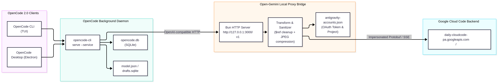

# Open-Gemini: Route Google Antigravity Models to OpenCode (CLI & Desktop)

**Open-Gemini** is a hardened OpenAI-compatible local proxy bridge and one-command installer that routes Google Antigravity (`agy`) models—including **Gemini 3.8 Flash**, **Gemini 4 Argon**, **Gemini 3.1 Pro**, and **Claude 4.6 Opus / Sonnet Thinking**—into **OpenCode 2.0+** (both the TUI CLI and Electron Desktop app).

---

## Why This Exists (Why Existing Plugins & Proxies Break on OpenCode 2.0)

If you tried using community plugins like `opencode-antigravity-auth` or an unpatched `antigravity-proxy` with OpenCode 2.0+, you likely encountered one of five failure modes:

1. **OpenCode 2.0 Plugin Loader Rejection (`Missing key at ["default"]`)**:
   OpenCode 2.0 requires dynamic plugins to provide an ES module `default` export (`export default { id, setup }`). Legacy auth plugins only export named functions.
2. **Unmapped `gemini-3.8-flash-tiered` & `gemini-4-argon` Slugs (`HTTP 404`)**:
   Google's internal Cloud Code backend (`daily-cloudcode-pa.googleapis.com`) exposes Gemini 3.8 Flash under the canonical slug `gemini-3.8-flash-tiered` and assigns `tieredModelIds.pro` / `tieredModelIds.flash` to `gemini-3.8-flash-tiered` while `agy` v1.4.3 resolves `Gemini 4 Argon` via its client-side `StaticCatalog`. Sending raw UI names returns `HTTP 404 Requested entity was not found`.
3. **The `$ref` Protobuf Tool-Response Bug (`Access denied: unknown_error`)**:
   When OpenCode or MCP tools (such as Context7) return JSON schemas containing `$ref`, `$defs`, or `#/` strings inside tool outputs, Google's internal `v1internal:streamGenerateContent` parser attempts to resolve `$ref` against internal protobuf schema parts and rejects the payload with `HTTP 400 INVALID_ARGUMENT`. Unpatched proxies retry HTTP 400 across fallback endpoints until hitting internal Google employee `.sandbox.googleapis.com` / `autopush-` endpoints that return `403 SUBSCRIPTION_REQUIRED`—masking a tool serialization bug as `Access denied: unknown_error`.
4. **Multimodal Upload Timeouts (`1m 14s` Hang -> `Access denied: unknown_error`)**:
   Reading multiple high-resolution PNGs (e.g., from `pdftoppm -png`, ~2 MB per page) bloats the conversation payload past 7 MB per turn. Over typical upload links, uploading 7+ MB exceeds a 30-second timeout and triggers the same broken `.sandbox.googleapis.com` fallback cascade.
5. **Hidden Models in OpenCode CLI & Desktop Pickers**:
   OpenCode 2.0 requires an active entry in its SQLite `credential` table, `favorite`/`recent` entries in `~/.local/state/opencode/model.json` (CLI), and explicit `"visibility": "show"` overrides in `drafts.sqlite` (Desktop UI, which otherwise hides custom models because their `time.released` defaults to `0` / epoch 1970).

**Open-Gemini fixes all five automatically.**

---

## Architecture



---

## Quickstart (One-Command Setup)

### Prerequisites
- [Bun](https://bun.sh) (`>= 1.0.0`)
- [OpenCode](https://opencode.ai) (`>= 2.0.0`)
- ImageMagick (`convert`) installed for automatic inline PNG-to-JPEG compression (optional; falls back gracefully to original image bytes if absent)

### Install & Auto-Configure

```bash
git clone https://github.com/<your-username>/open-gemini.git
cd open-gemini
bun install
bun run setup
```

### What `bun run setup` Does Automatically
1. **Seeds Your Antigravity OAuth Account**:
   Automatically imports your existing OAuth refresh token from `~/.gemini/antigravity-cli/antigravity-oauth-token` or `~/.local/share/opencode/auth.json`, exchanges it for a live access token, discovers your Google Cloud Code `projectId`, and writes `antigravity-accounts.json` (`0600` permissions). If no local token is found, it gives you the one-click browser login URL (`http://127.0.0.1:3000/oauth/start`).
2. **Configures `~/.config/opencode/opencode.json`**:
   Registers the `antigravity` provider (`@ai-sdk/openai-compatible` -> `http://127.0.0.1:3000/v1`) and all models.
3. **Activates the OpenCode Credential**:
   Registers the `antigravity` credential via `opencode api POST /api/credential` so OpenCode treats the provider as connected.
4. **Enables Model Picker Visibility in CLI & Desktop**:
   - Populates `favorite`, `recent`, and `variant` in `~/.local/state/opencode/model.json` for the CLI picker (`<leader>m` / `F2`).
   - Updates `opencode.global.dat` -> `model` in OpenCode Desktop's `drafts.sqlite` with `"visibility": "show"`.
5. **Installs & Starts the Background Service**:
   - **Linux**: Installs and starts `~/.config/systemd/user/antigravity-proxy.service`.
   - **macOS**: Installs and loads `~/Library/LaunchAgents/com.opencode.antigravity-proxy.plist`.

---

## Included Models

| OpenCode Model ID | Display Name | Upstream Target | Variants | Context / Output |
| :--- | :--- | :--- | :--- | :--- |
| `antigravity/antigravity-gemini-3.8-flash` | `Gemini 3.8 Flash` | `gemini-3.8-flash-tiered` | — | 1,048,576 / 65,536 |
| `antigravity/antigravity-gemini-4-argon` | `Gemini 4 Argon` | `gemini-3.8-flash-tiered` (32k budget) | — | 1,048,576 / 65,536 |
| `antigravity/antigravity-claude-opus-5-5` | `Claude Opus 5.5` | `claude-opus-5-5-(low\|medium\|high)` | `#low`, `#medium`, `#high` | 1,000,000 / 64,000 |
| `antigravity/antigravity-claude-sonnet-5-5` | `Claude Sonnet 5.5` | `claude-sonnet-5-5-(low\|medium\|high)` | `#low`, `#medium`, `#high` | 1,000,000 / 64,000 |
| `antigravity/antigravity-gpt-oss-120b-medium` | `GPT-OSS 120B (Medium)` | `gpt-oss-120b-medium` | — | 131,072 / 16,384 |

---

## Verification

```bash
# Test Gemini 3.8 Flash
opencode run -m antigravity/antigravity-gemini-3.8-flash "Say hello"

# Test Gemini 4 Argon (3.8 Flash with 32k thinking budget)
opencode run -m antigravity/antigravity-gemini-4-argon "Say hello"

# Test Claude Opus 5.5 (default medium reasoning)
opencode run -m antigravity/antigravity-claude-opus-5-5 "Say hello"

# Test Claude Opus 5.5 with high reasoning effort
opencode run -m antigravity/antigravity-claude-opus-5-5#high "Say hello"

# Test Claude Sonnet 5.5
opencode run -m antigravity/antigravity-claude-sonnet-5-5 "Say hello"

# Test GPT-OSS 120B
opencode run -m antigravity/antigravity-gpt-oss-120b-medium "Say hello"

# Check service logs (Linux)
journalctl --user -u antigravity-proxy.service -f
```

---

## Key Technical Fixes Under the Hood

### 1. Recursive `$ref` / `#/` Tool Output Sanitization (`src/utils/transform.ts`)
Google's internal `v1internal` endpoint parses `functionResponse.response` as a protobuf `Struct` and treats any `$ref` key or `#/...` value as an internal schema reference. `sanitizeToolResponseObject` recursively rewrites `$`-prefixed keys (`$ref` -> `_ref`, `$defs` -> `_defs`, `$schema` -> `_schema`) and strips leading `#/` from string values before sending tool results upstream.

### 2. Automatic Inline Base64 Image Compression (`src/utils/transform.ts`)
When tools read large uncompressed PNGs (`> 250 KB`), `compressInlineImage` transcodes them in-memory to JPEG (`1600x1600>`, quality 82) and caches the result by SHA-256 hash (`IMAGE_COMPRESS_CACHE`), shrinking 2 MB PDF page scans down to ~180 KB (**11x smaller**) and preventing multi-image upload timeouts.

### 3. Production Endpoint Pinning & HTTP 400 Halt (`config.json`, `src/server.ts`)
Removed internal Google employee endpoints (`daily-cloudcode-pa.sandbox.googleapis.com`, `autopush-cloudcode-pa.sandbox.googleapis.com`) that return false `403 SUBSCRIPTION_REQUIRED` errors, increased request timeouts to `180000`ms (3 minutes), and halted retry loops immediately on HTTP 400.

---

## Security
- **Never commit `antigravity-accounts.json`**. It contains your OAuth refresh and access tokens and is ignored by `.gitignore`.
